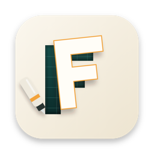

<p align="center">
  <picture>
    <source media="(prefers-color-scheme: dark)" srcset="assets/branding/icon-dark-256.png">
    
  </picture>
</p>

<h1 align="center">FlatCraft</h1>

<p align="center">
  <strong>Your cutting plotter, leveled up.</strong><br>
  You bought it, so you're in control: every setting, every cut, on your own computer.
  Pro results for every plotter. Agents welcome.<br>
  An open-source desktop app for cutting plotters. Bring in a design,
  place it on the mat and cut it. Or let your AI agent prepare the job through the built-in MCP server.
</p>

<p align="center">
  <a href="#status">Status</a> ·
  <a href="#what-it-does">Features</a> ·
  <a href="#ai-agents-mcp">MCP</a> ·
  <a href="#safety-first">Safety</a> ·
  <a href="docs/protocol/gpgl.md">Protocol notes</a> ·
  <a href="CONTRIBUTING.md">Contributing</a> ·
  <a href="#sponsors">Sponsor</a>
</p>

<p align="center">
  <a href="LICENSE"></a>
  <a href="#status"></a>
  <a href="https://github.com/jordiboehme/crystalline"></a>
  <a href="https://github.com/jordiboehme/flatcraft/stargazers"></a>
  <a href="https://ko-fi.com/V7V31T6CL9"></a>
</p>


You have a cutting plotter. It works fine. The software that drives it is about to stop working on your computer. That's how good machines end up in landfill: not broken, just abandoned.

FlatCraft is the way out. It works like a slicer for 3D printers: one profile per plotter, one per material, your own presets on top. Alessandro Ranellucci with Slic3r and Josef Průša with PrusaSlicer showed how good that feels for printers. FlatCraft brings it to flat things.

One Rust app. No account, no cloud, no subscription. Where we're going, we don't need logins.

## Status

Early. Nothing to download yet, but you can build it.

- Done: M1, the slicer app with File Output. It was built in the open, one reviewed task at a time ([PR #1](https://github.com/jordiboehme/flatcraft/pull/1)).
- Next: M2, a knife simulator that measures cut quality, and the final path algorithms.
- Then: M3, cutting over USB on a real plotter, with ruler tests and a calibration wizard.
- Later: M4, a signed app, Homebrew and self-update.

Star the repo if you want to see it cut. Don't stop believin'.

## What it does

M1 is the slicer half: everything up to the blade. The jobs land in File Output for now, byte for byte what the plotter would get.

- **Import in true size:** SVG in px, mm or inches comes in at the right size. PNG, JPEG, WebP and GIF are traced into cut outlines. The Trace dialog shows a live preview and counts the specks it cleans up, so dust on a scan doesn't turn into confetti.
- **Cut what you mean:** cut all lines as drawn, or the outlines of the objects. Strokes are cut on auto, as a centre line or around their outline.
- **Cut quality first:** holes before outlines, so a piece never moves before it's done. An overcut that closes every shape. Passes that finish one shape, lap by lap, before the blade moves on.
- **Arrange like a slicer:** move, scale, rotate, mirror, align and auto-arrange on the mat. No vector editor, no node fiddling: bring it in, place it, cut it.
- **Mats that know their grid:** every mat has a colour and a printed grid with an origin you can calibrate. FlatCraft's 0,0 is the 0,0 printed on your mat, so what you see on the canvas is where the blade goes.
- **Linked source files:** FlatCraft remembers where a design came from. Changed it in another app? Reload. Moved it? Reconnect. Done with it? Unlink. The project keeps its own copy, so a missing file never breaks a project.
- **Two workspaces:** Prepare (ribbon, objects, settings) and Cut (device and material, path preview with the cut order, and a timeline to scrub through the job).
- **File Output:** the exact bytes the plotter would get, plus a readable listing that names the object, path and pass of every command. Think G-code for your plotter. It's the default device, so nothing moves by accident. The files land in `<Documents>/FlatCraft Output`; pick another folder in Settings > App.
- **One app, many plotters:** every machine gets a profile: the language it speaks, how it connects and what it can do. A new plotter is a new profile, not a new app.
- **Profiles, PrusaSlicer style:** plotter and material presets with inheritance, edited in the Profiles window. Speed, force, passes and overcut per material, and a quick override per job.
- **Agents welcome, blade stays yours:** an agent can prepare jobs and send them to File Output. A USB cut started by an agent waits for your click in the window, or for a setting you turned on yourself.
- **Test patterns and a capture tool:** a test sheet with squares, circles, sharp tips, an asymmetric F and rulers, to check scale and mirroring. And `cargo xtask capture`, which turns a Wireshark recording of the vendor software into test fixtures, for the clean-room protocol work.

Screenshots are coming. The app is still teasing its hair for the album cover.

### What comes next

- **M2:** a knife simulator that scores every cut, start points on corners, passes chained without lifting the blade, and the final path order.
- **M3:** cutting over USB on a real plotter, plus a calibration and mat assistant that measures your mat's grid for you.

## Build from source

You need Rust (rustup picks the right version from `rust-toolchain.toml`):

```sh
git clone https://github.com/jordiboehme/flatcraft.git
cd flatcraft
cargo test --workspace
cargo build --release
```

The app is `target/release/flatcraft`. Start it without arguments to open the window.

On Linux you also need the window system headers:

```sh
sudo apt-get install libxkbcommon-dev libgl1-mesa-dev libx11-dev libxcursor-dev libxrandr-dev libxi-dev libwayland-dev
```

## AI agents (MCP)

FlatCraft speaks [MCP](https://modelcontextprotocol.io) over stdio. Your agent's client starts it, so there's no server to run, no port and no token. Use the full path to the `flatcraft` binary.

For Claude Code:

```sh
claude mcp add flatcraft -- /path/to/flatcraft mcp --window
```

For Claude Desktop, add it to `claude_desktop_config.json` (Settings > Developer > Edit Config) and restart the app:

```json
{
  "mcpServers": {
    "flatcraft": {
      "command": "/path/to/flatcraft",
      "args": ["mcp", "--window"]
    }
  }
}
```

With `--window` the app opens and you watch the agent work. Without it FlatCraft runs headless, which is fine for File Output.

Everything a person can do, an agent can do too, from the same command list: import, trace, arrange, pick plotter, material and mat, preview and send to File Output. The server has six tools:

| Tool | What it does |
|---|---|
| `version` | App version, the active plotter and material, and whether a window is open |
| `list_commands` | All commands, with an optional filter |
| `describe_command` | The full description and parameter schema of one command |
| `execute` | Runs a command as an agent |
| `document` | The state of the active document |
| `preview` | A PNG of the canvas or of the cut path |

Units are millimetres. The origin is the 0,0 of the grid printed on the mat, y points down.

The blade stays your call. A USB cut started by an agent needs your click in the window, or a setting you turned on yourself. An agent can't change your preferences either.

## Safety first

A cutting plotter has a blade, and a blade has no undo button. FlatCraft follows a few hard rules:

- **No calibration writes:** FlatCraft can't send the commands that change a plotter's factory calibration. A last check on every byte refuses anything it doesn't know.
- **No half jobs:** a job that was sent completely ends with "home". If a write fails halfway, FlatCraft sends nothing more. Don't panic: use the stop button on the machine.
- **People confirm real cuts:** an agent can prepare a cut, but a USB cut needs your click or a setting you turned on yourself.
- **No double knife correction:** the blade offset is corrected in exactly one place, on the plotter or in FlatCraft, never both.

With great power comes great responsibility. With great force comes a cut mat.

## Why

There's a Cameo 2 on my desk. It's years old and it still cuts fine. The vendor software will soon drop support for my system, and then it's a very precise paperweight.

Adam Savage likes to say that failure is always an option. Giving up on a working machine shouldn't be.

So FlatCraft is long-life software for the plotters we already own. It's in the spirit of the makers who share how they work: Adam Savage, Josef Průša, Laura Kampf, Felix Schelhasse, Simone Giertz and Jimmy DiResta. Build it, fix it, keep it running.

## Principles

Super massive stability stuff, as Felix Schelhasse would say. Here's FlatCraft's version:

- **Yours:** you bought the plotter, so you decide how it cuts. Your files, your machine, your settings. No account, no cloud, no subscription.
- **Local only:** no cloud services, no telemetry. Your designs stay on your machine.
- **Measured, not guessed:** cut quality gets tested with a knife simulator (M2) and with a ruler on real paper (M3).
- **Clean licenses:** FlatCraft uses only libraries with permissive or MPL licenses.
- **Honest output:** when something can't be cut, FlatCraft says what and why.

## Inspired by software I love

- [PrusaSlicer](https://github.com/prusa3d/PrusaSlicer)
- [SolidCraft](https://github.com/tangency-labs/solidcraft)
- [ZigZag](https://github.com/simpsoka/zigzag)

## Broken, missing or your plotter?

> "Every defect gets respect." - Laura Kampf

- **Something doesn't work:** [open a bug report](https://github.com/jordiboehme/flatcraft/issues/new?template=bug_report.yml). If a cut looks wrong, attach the `.gpgl.txt` listing from File Output.
- **Your plotter isn't supported yet:** [ask for your plotter](https://github.com/jordiboehme/flatcraft/issues/new?template=plotter_support.yml). Name the model and its USB IDs. A USB recording of a simple cut from the vendor software helps a lot.
  Every new plotter needs testing on the real machine. If you want more plotters supported, you can support the project on [Ko-fi](https://ko-fi.com/V7V31T6CL9) or [PayPal](https://paypal.me/jordiboehmelopez). Or send me a plotter. ;)
- **You have an idea:** "Maybe a toothbrush helmet isn't the answer, but at least you're asking the question." (Simone Giertz) [Request a feature](https://github.com/jordiboehme/flatcraft/issues/new?template=feature_request.yml). Tell what you want to do and what stops you today.

## Contributing

Help is welcome, most of all from people with a plotter on their desk. [CONTRIBUTING.md](CONTRIBUTING.md) covers how to build and test, the clean-room rule for protocol work and how to report a plotter that isn't supported yet. Open work is in [GitHub issues](https://github.com/jordiboehme/flatcraft/issues). For a security problem, read [SECURITY.md](SECURITY.md).

## Sponsors

FlatCraft is free and open source. If it saved your plotter from the bin, you can support the work here:

[](https://ko-fi.com/V7V31T6CL9)
[](https://paypal.me/jordiboehmelopez)

Want to sponsor support for your plotter? [Open an issue](https://github.com/jordiboehme/flatcraft/issues) and let's talk.

## Disclaimer

FlatCraft drives a machine with a blade. Use it at your own risk: start with paper and a shallow blade, and keep a hand near the stop button. The software comes as is, without warranty (see the [license](LICENSE)).

## License

[MPL-2.0](https://www.mozilla.org/en-US/MPL/2.0/). FlatCraft was written from public protocol facts and its own notes, without copying code from other plotter drivers.

FlatCraft is independent. It is not affiliated with, sponsored by or endorsed by Silhouette America or Graphtec. Silhouette and Cameo are trademarks of their owners, named only to describe compatibility.

> "You want to make something that the very next morning the minute you wake up you want to run to your shop and look at it." - Jimmy DiResta

*Keep cutting.*
