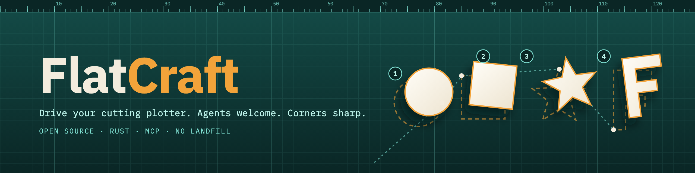

<p align="center">
  
</p>

# FlatCraft

**Your cutting plotter, back in the game. Agents welcome.**

[](LICENSE)
[](#status)
[](https://github.com/jordiboehme/crystalline)

You have a cutting plotter. It works fine. The software that drives it is about to stop working on your computer. That's how good machines end up in landfill: not broken, just abandoned.

FlatCraft is the way out. It's an open-source desktop app for cutting plotters, starting with the Silhouette Cameo 2. Bring in an SVG or a picture, place it on the mat, pick your material and cut. It works like a slicer for 3D printers: one profile per plotter, one per material, and your own presets on top. Josef Prusa showed how good that feels for printers. FlatCraft brings it to flat things.

It also speaks MCP. Your agent can import, arrange, preview and prepare a cut through the same commands you use in the app. The blade stays your call.

One Rust app. No account, no cloud, no subscription. Where we're going, we don't need logins.

## Status

Early. Nothing to download yet.

- Now: M1, the slicer app with File Output. It's built in the open, one reviewed task at a time ([PR #1](https://github.com/jordiboehme/flatcraft/pull/1)).
- Next: M2, a knife simulator that measures cut quality, and the final path algorithms.
- Then: M3, USB for a real Cameo 2, with ruler tests and a calibration wizard.
- Later: M4, a signed app, Homebrew and self-update.

Star the repo if you want to see it cut. Don't stop believin'.

## What it will do

- **Import in true size.** SVG in px, mm or inches comes in at the right size. PNG, JPEG, WebP and GIF are traced into cut outlines, with a live preview.
- **Arrange like a slicer.** Move, scale, rotate, mirror, align and auto-arrange on the mat. No vector editor, no node fiddling: bring it in, place it, cut it.
- **Profiles, PrusaSlicer style.** Plotter and material presets with inheritance. Speed, force and passes per material, and a quick override per job.
- **Cut quality first.** Holes before outlines, so a piece never moves before it's done. Start points on corners. An overcut that closes every shape. Passes that stay on one shape until it's finished.
- **File Output.** The exact bytes the plotter would get, plus a readable listing of every command. Think G-code for your plotter. It's the default device, so nothing moves by accident.
- **Built for agents.** An MCP server on localhost with a token. Everything a person can do, an agent can do too, from the same command list.

## Safety first

A cutting plotter has a blade, and a blade has no undo button. FlatCraft follows a few hard rules:

- **No calibration writes.** FlatCraft can't send the commands that change a plotter's factory calibration. A last check on every byte refuses anything it doesn't know.
- **No half jobs.** A job that was sent completely ends with "home". If a write fails halfway, FlatCraft sends nothing more. Don't panic: use the stop button on the machine.
- **People confirm real cuts.** An agent can prepare a cut, but a USB cut needs your click or a setting you turned on yourself.
- **No double knife correction.** The blade offset is corrected in exactly one place: on the plotter or in FlatCraft, never both.

With great power comes great responsibility. With great force comes a cut mat.

## Why

There's a Cameo 2 on my desk. It's years old and it still cuts fine. The vendor software will soon drop support for my system, and then it's a very precise paperweight.

Adam Savage likes to say that failure is always an option. Giving up on a working machine shouldn't be.

So FlatCraft is long-life software for the plotters we already own. It's written from scratch in Rust, with its own protocol notes and its own path algorithms. It's in the spirit of the makers who share how they work: Adam Savage, Josef Prusa, Laura Kampf and Felix Schelhasse. Build it, fix it, keep it running.

## Principles

- **Local only.** No cloud services, no telemetry. Your designs stay on your machine.
- **Measured, not guessed.** Cut quality is tested with a simulator and with a ruler on real paper.
- **Clean licenses.** FlatCraft uses only libraries with permissive or MPL licenses. It was written from public protocol facts, without copying code from GPL drivers.
- **Honest output.** When something can't be cut, FlatCraft says what and why.

## Try it

M1 lives on the `m1-slicer` branch until it's done. You need Rust (rustup picks the right version from `rust-toolchain.toml`):

```sh
git clone -b m1-slicer https://github.com/jordiboehme/flatcraft.git
cd flatcraft
cargo test --workspace
```

## Support

FlatCraft is free and open source. If it saved your plotter from the bin, you can support the work here:

[](https://ko-fi.com/V7V31T6CL9)
[](https://paypal.me/jordiboehmelopez)

Have a plotter FlatCraft should support? [Open an issue](https://github.com/jordiboehme/flatcraft/issues) and let's talk.

## License

[MPL-2.0](https://www.mozilla.org/en-US/MPL/2.0/)

Silhouette and Cameo are trademarks of their owners. FlatCraft is not affiliated with Silhouette America or Graphtec.

*Keep cutting.*
